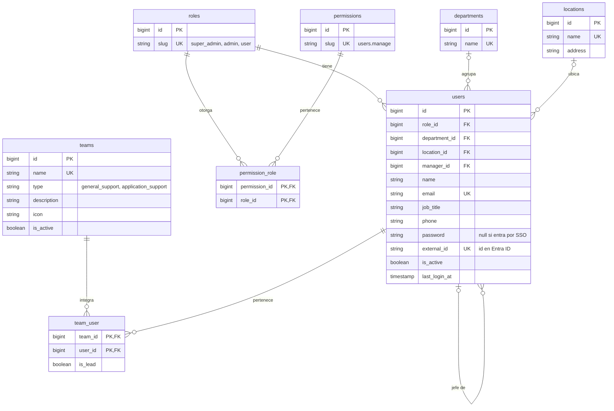

# Arquitectura · Mesa de Ayuda TI

Monolito modular en Laravel 13 + Inertia 2 + React 19 (TypeScript) + Tailwind 4.
El código está en inglés; la interfaz, en español (`lang/es`).

## Roles

| Rol (`slug`)  | Quién es                 | Qué hace                                                         |
| ------------- | ------------------------ | ---------------------------------------------------------------- |
| `user`        | Colaborador              | Crea tickets y sigue los suyos.                                  |
| `admin`       | Personal de TI           | Atiende los tickets de los equipos a los que pertenece.          |
| `super_admin` | Dirección TIC            | Todo lo anterior y configura la plataforma.                      |

El liderazgo no es un rol global: es `team_user.is_lead`, por equipo.

Cada permiso (`App\Domain\Identity\Enums\PermissionSlug`) se registra como un *gate*
(`can:users.manage`). El super admin pasa todos los gates (`Gate::before`).
Los permisos por defecto de cada rol están en `PermissionSlug::defaultsFor()` y los
siembra `RolePermissionSeeder`, que nunca quita permisos otorgados después.

## Estructura

```
app/
├── Domain/                     Lógica de negocio, agrupada por dominio
│   ├── Identity/               Usuarios, roles y permisos
│   ├── Organization/           Departamentos, sedes y equipos de TI
│   └── Shared/                 Piezas usadas por varios dominios (Icon, HasTranslatedLabel)
│       (cada dominio: Actions/ Enums/ Listeners/ Models/ …)
├── Http/
│   ├── Controllers/Management/ Área de configuración (super admin)
│   ├── Requests/Management/    Validación de cada formulario
│   ├── Resources/              Lo único que llega a React: nunca se envía un modelo completo
│   └── Middleware/
routes/
├── web.php                     Inicio y perfil
├── auth.php                    Inicio de sesión (sin registro público)
└── management.php              /management/* — cada recurso protegido por su permiso
resources/js/
├── Components/ui/              Sistema de diseño (botones, campos, tarjetas, iconos…)
├── Layouts/                    AppLayout (barra lateral + superior) y GuestLayout
├── Pages/{Area}/{Recurso}/     Index, Create, Edit y Partials/
├── lib/                        Utilidades sin interfaz (classNames, formatRelative)
└── types/                      Tipos que reflejan los Resources de Laravel
```

Áreas: `Portal` (colaboradores), `Desk` (personal de TI) y `Management` (configuración).
Se nombran por función y no por rol, para poder delegar permisos sin mover rutas.

### Recorrido de una petición

`Ruta (can:permiso)` → `Controller` delgado → `FormRequest` (validación) →
`Action` del dominio (transacción) → `Model` → redirección con mensaje flash.
Las lecturas pasan por un `Resource` antes de llegar a la página de Inertia.

## Convenciones de nombres

- **Tablas:** plural y `snake_case`. Pivotes en singular y orden alfabético (`team_user`).
- **FK a usuarios:** por el papel de la persona (`requester_id`, `assignee_id`). En historiales,
  `user_id` es quien hizo la acción.
- **Booleanos** `is_` / `has_`; **fechas con hora** `_at`; **duraciones** con unidad (`_minutes`).
- **Enums:** lo que la lógica usa es un *backed enum* de PHP guardado como texto; lo que el
  negocio configura desde pantallas es una tabla. Las etiquetas salen de `lang/es/enums.php`.
- **Clases:** Actions verbo + sustantivo (`CreateUser`), eventos en pasado, requests
  `Store…Request` / `Update…Request`.
- **No se borra, se desactiva:** usuarios y equipos tienen `is_active`; no hay borrado lógico.
- **Rutas:** URL en `kebab-case`, nombres con puntos (`management.users.index`).
- **React:** componentes en PascalCase, variables y props en camelCase, sin abreviaturas.

## Base de datos (implementada)



Todas las tablas tienen `created_at` y `updated_at`.

### Ajustes frente a la propuesta inicial

- `roles` y `permissions` solo guardan el `slug`: el nombre y la descripción salen de las
  traducciones del enum, así no se repite el mismo dato en dos lugares.
- `teams` y `categories` no llevan `slug`: las URL usan el `id` y el slug se derivaba del nombre.
- Se quitó `deleted_at` de usuarios, equipos y categorías: se usa solo `is_active`.

### Próximas tablas

Catálogo y SLA (`categories`, `sla_policies`, `sla_targets`, `business_calendars`,
`business_hours`, `holidays`), plantillas (`message_templates`), SSO
(`identity_providers`, `directory_groups`, `directory_group_team`), tickets y auditoría.
