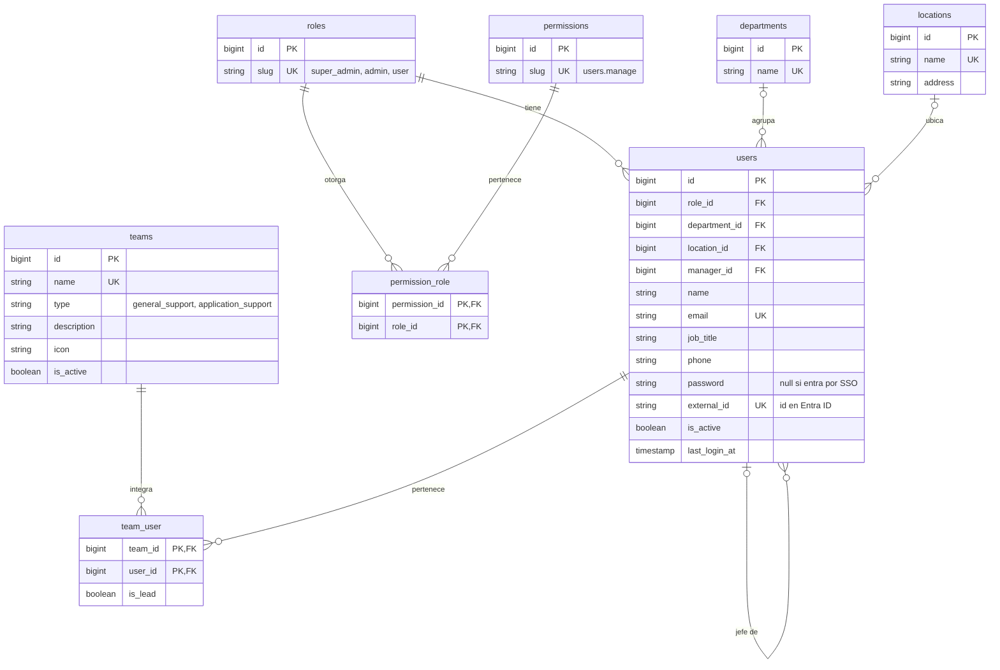
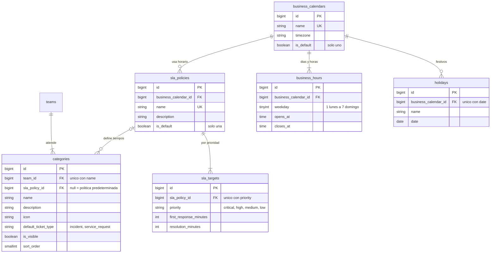
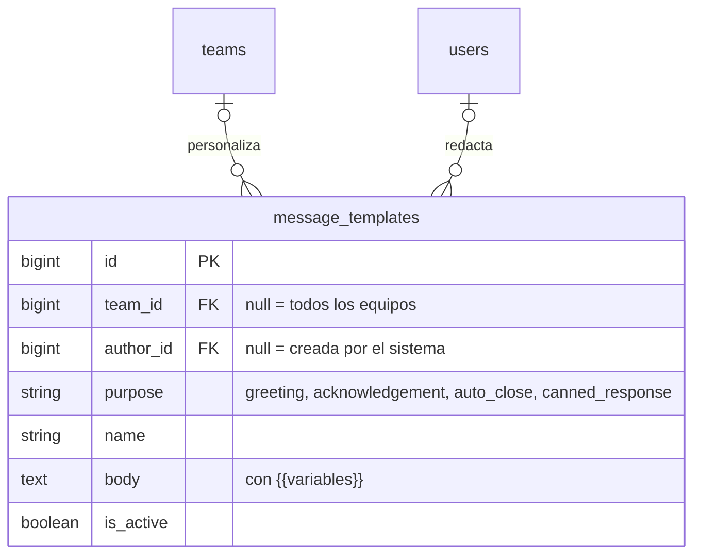
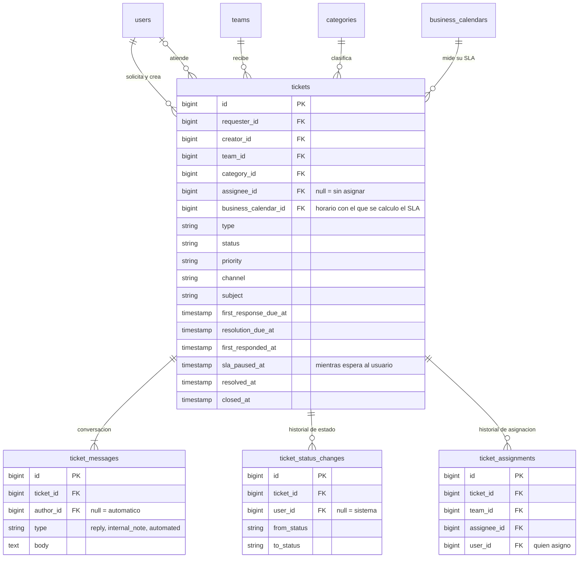
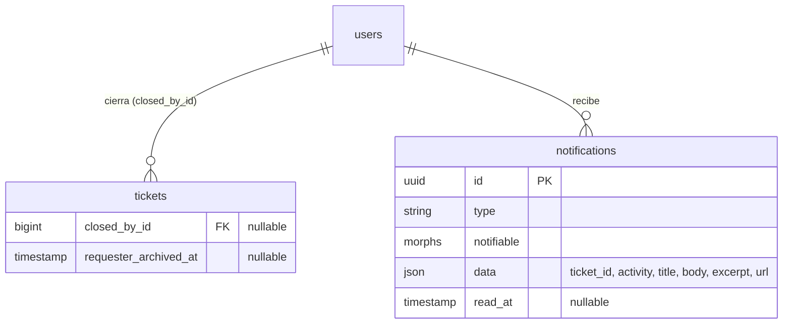

# Arquitectura · Mesa de Ayuda TI

Monolito modular en Laravel 13 + Inertia 2 + React 19 (TypeScript) + Tailwind 4.
El código está en inglés; la interfaz, en español (`lang/es`).

## Roles

| Rol (`slug`)  | Quién es                 | Qué hace                                                         |
| ------------- | ------------------------ | ---------------------------------------------------------------- |
| `user`        | Colaborador              | Crea tickets y sigue los suyos.                                  |
| `admin`       | Personal de TI           | Atiende los tickets de sus equipos. Si lidera uno, agrega auxiliares y sigue su rendimiento. |
| `super_admin` | Dirección TIC            | Todo lo anterior y configura la plataforma.                      |

El liderazgo no es un rol global: es `team_user.is_lead`, por equipo. Un **líder** es un `admin`
con `is_lead` en ese equipo y el permiso `teams.lead`; un **auxiliar** es un integrante sin
`is_lead`. Así una persona puede liderar un equipo y ser auxiliar en otro.

Los permisos de `admin` y `user` se editan en **Roles y permisos**. Por seguridad:

- `roles.manage` e `identity_providers.manage` están reservados al super admin
  (`PermissionSlug::isReservedForSuperAdmin()`): no se pueden delegar y, aunque
  aparecieran en la base de datos para otro rol, `User::hasPermission()` los ignora.
- Si se delega la gestión de usuarios, solo un super admin puede asignar el rol
  super admin o editar a un super admin (`UserPolicy`).

Cada permiso (`App\Domain\Identity\Enums\PermissionSlug`) se registra como un *gate*
(`can:users.manage`). El super admin pasa todos los gates (`Gate::before`).
Los permisos por defecto de cada rol están en `PermissionSlug::defaultsFor()` y los
siembra `RolePermissionSeeder`, que nunca quita permisos otorgados después.

## Estructura

```
app/
├── Domain/                     Lógica de negocio, agrupada por dominio
│   ├── Identity/               Usuarios, roles y permisos
│   ├── Organization/           Departamentos, sedes y equipos de TI
│   ├── Catalog/                Categorías de atención
│   ├── ServiceLevel/           Políticas de SLA, horarios laborales y festivos
│   ├── Ticketing/              Tickets, mensajes, plantillas, eventos y notificaciones
│   ├── Reporting/              Estadísticas: periodo, filtros y métricas (TicketStatistics)
│   └── Shared/                 Piezas usadas por varios dominios (Icon, HasTranslatedLabel, HasSingleDefault)
│       (cada dominio: Actions/ Enums/ Listeners/ Models/ …)
├── Http/
│   ├── Controllers/Portal/     Área de quien pide soporte
│   ├── Controllers/Desk/       Área de TI: bandeja, tickets y “Mi equipo” del líder
│   ├── Controllers/Reports/    Estadísticas globales
│   ├── Controllers/Management/ Área de configuración (super admin)
│   ├── Requests/Management/    Validación de cada formulario
│   ├── Resources/              Lo único que llega a React: nunca se envía un modelo completo
│   └── Middleware/
routes/
├── web.php                     Inicio, perfil, adjuntos, notificaciones y estadísticas
├── portal.php                  /portal/* — tickets propios
├── desk.php                    /desk/* — bandeja, tickets de los equipos y equipos que se lideran
├── auth.php                    Inicio de sesión (sin registro público)
└── management.php              /management/* — cada recurso protegido por su permiso
resources/js/
├── Components/ui/              Sistema de diseño (botones, campos, tarjetas, iconos…)
├── Components/{Dominio}/       Piezas de negocio reutilizables (Ticketing/PriorityBadge)
├── Layouts/                    AppLayout (barra lateral + superior) y GuestLayout
├── Pages/{Area}/{Recurso}/     Index, Create, Edit y Partials/
├── lib/                        Utilidades sin interfaz (classNames, formatDuration, formSubmitOptions)
└── types/                      Tipos que reflejan los Resources de Laravel
```

Áreas: `Portal` (colaboradores), `Desk` (personal de TI) y `Management` (configuración).
Se nombran por función y no por rol, para poder delegar permisos sin mover rutas.

### Recorrido de una petición

`Ruta (can:permiso)` → `Controller` delgado → `FormRequest` (validación) →
`Action` del dominio (transacción) → `Model` → redirección con mensaje flash.
Las lecturas pasan por un `Resource` antes de llegar a la página de Inertia.

## Convenciones de nombres

- **Tablas:** plural y `snake_case`. Pivotes en singular y orden alfabético (`team_user`).
- **FK a usuarios:** por el papel de la persona (`requester_id`, `assignee_id`). En historiales,
  `user_id` es quien hizo la acción.
- **Booleanos** `is_` / `has_`; **fechas con hora** `_at`; **duraciones** con unidad (`_minutes`).
- **Enums:** lo que la lógica usa es un *backed enum* de PHP guardado como texto; lo que el
  negocio configura desde pantallas es una tabla. Las etiquetas salen de `lang/es/enums.php`.
- **Clases:** Actions verbo + sustantivo (`CreateUser`), eventos en pasado, requests
  `Store…Request` / `Update…Request`.
- **No se borra, se desactiva:** usuarios y equipos tienen `is_active`; no hay borrado lógico.
- **Rutas:** URL en `kebab-case`, nombres con puntos (`management.users.index`).
- **React:** componentes en PascalCase, variables y props en camelCase, sin abreviaturas.

## Base de datos (implementada)



Catálogo y niveles de servicio:



Todas las tablas tienen `created_at` y `updated_at`.

Reglas de negocio de esta parte:

- Siempre hay exactamente un horario y una política predeterminados (`HasSingleDefault`).
  Marcar uno nuevo desmarca el anterior; el actual no se puede desmarcar directamente.
- Los minutos de SLA son minutos **laborales** del horario de la política.
- La resolución nunca puede tomar menos tiempo que la primera respuesta.
- Los nombres de categoría son únicos dentro de cada equipo, no en toda la plataforma.
- `ServiceLevelSeeder` crea el horario y la política predeterminados en cualquier ambiente.

Plantillas de mensajes:



- Los mensajes automáticos (`greeting`, `acknowledgement`, `auto_close`) admiten una plantilla
  activa general y una más por equipo; la del equipo reemplaza a la general.
- Las variables válidas están en `TemplateVariable`. `{{agent.name}}` no se permite en el acuse
  de recibo porque todavía no hay agente. `MessageTemplateSeeder` crea las tres generales.

Tickets:



Flujo y reglas:

- **Crear (portal):** la categoría decide equipo, tipo y política de SLA. Las fechas de vencimiento
  se calculan en horas laborales con `BusinessTimeCalculator`. La descripción es el primer mensaje.
  El evento `TicketCreated` dispara `SendAcknowledgementMessage`.
- **Tomar (bandeja):** asignación atómica (`TakeTicket`): si dos agentes pulsan a la vez, solo uno
  gana. El evento `TicketTaken` dispara `SendGreetingMessage`, que envía el saludo del equipo en
  nombre del agente y cuenta como primera respuesta.
- **Responder:** solo escribe quien tiene el ticket asignado. Cualquier otro agente del equipo ve
  el chat en solo lectura y, al intentar escribir, se le pregunta «¿Quieres tomar este ticket?».
  El chat ya no tiene notas internas. Si el solicitante responde a un ticket en espera o resuelto,
  vuelve a "En proceso".
- **SLA:** "Esperando al usuario" pausa el reloj (`sla_paused_at`). Al reanudar, las fechas
  pendientes se corren el tiempo laboral que estuvo en pausa. `TicketSlaTracker` indica si va en
  plazo, en riesgo (queda menos del 25 %), vencido, en pausa, cumplido o incumplido.
- **Permisos:** `TicketPolicy`. El solicitante solo ve sus tickets; el agente, los de sus equipos.
- **Adjuntos** (`ticket_attachments`, por mensaje): hasta 5 archivos de 10 MB, solo imágenes,
  PDF, Office, CSV y texto. Se guardan en el disco privado y se descargan por
  `attachments.show`, que revisa `TicketAttachmentPolicy`: los de notas internas son solo de TI.
- **Reasignar** (`AssignTicket`): a otro integrante activo del equipo; deja nota interna. Si nadie
  lo había tomado, se envía el saludo en nombre de esa persona.
- **Transferir** (`TransferTicket`): a otro equipo con motivo obligatorio; vuelve a "Recibido",
  sin responsable, y el solicitante recibe un aviso. Los vencimientos no cambian.
- **Cambiar prioridad** (`ChangeTicketPriority`, permiso `tickets.change_priority`): recalcula
  los vencimientos desde la creación con los tiempos de la nueva prioridad, más las pausas
  terminadas que registra el historial de estados.
- **Encuesta** (`ticket_ratings`, una por ticket): de 1 a 5 estrellas con comentario opcional,
  cuando el ticket está resuelto o cerrado.

### Ajustes frente a la propuesta inicial

- `roles` y `permissions` solo guardan el `slug`: el nombre y la descripción salen de las
  traducciones del enum, así no se repite el mismo dato en dos lugares.
- `teams` y `categories` no llevan `slug`: las URL usan el `id` y el slug se derivaba del nombre.
- Se quitó `deleted_at` de usuarios, equipos y categorías: se usa solo `is_active`.

### Próximas tablas

Observadores de tickets, recordatorios y cierre automático, auditoría y SSO (`identity_providers`, `directory_groups`,
`directory_group_team`).

## Cierre por el usuario, líderes, notificaciones y estadísticas

Migraciones `2026_11_09_000001`–`000004`.



**Estados.** Los estados vigentes son Recibido (`received`, antes `new`), En proceso, Esperando
al usuario, Resuelto y Cerrado (`TicketStatus::current()`). "Esperando a un tercero" y "Cancelado"
quedaron retirados: la migración movió sus tickets a "En proceso" (o "Recibido" si no tenían
responsable) y a "Cerrado", y dejó ese paso en el historial con `user_id` nulo. Los casos siguen
en el enum, marcados `@deprecated`, solo para que el historial anterior se pueda leer; no se ofrecen
en filtros ni cambios de estado. El agente puede pasar un ticket a En proceso, Esperando al
usuario, Resuelto o Cerrado, siempre que alguien lo tenga asignado.

**Cierre por el usuario.** En "¿Ya se resolvió?" el solicitante puede:

- *Marcar como resuelto*: el ticket pasa a Cerrado y guarda quién (`closed_by_id`) y cuándo
  (`closed_at`). Si TI ya lo había resuelto, se conserva esa hora de resolución.
- *Quitar de mi lista*: archiva (`requester_archived_at`); no borra nada y TI lo sigue viendo.
  Si el ticket seguía abierto, primero se cierra, porque quitarlo significa que ya no necesita
  ayuda. Se recupera desde el filtro *Archivados*. Reabrir un ticket lo desarchiva.

Ambas acciones piden confirmación. Después aparece la encuesta de satisfacción.

**Tomar un ticket** (`TakeTicket`). Sirve para un ticket sin responsable y para quitárselo a un
compañero. La página envía a quién vio como responsable (`assignee_id`); la asignación es un
UPDATE condicionado a ese mismo dato, así nadie toma un ticket que cambió de manos sin verlo.
Tomar uno sin responsable envía el saludo; tomarlo de un compañero solo deja la actividad
«X tomó el ticket de Y», visible para TI.

**Chat.** Las notas internas que ya existían, y las que generan las acciones (asignar, transferir,
cambiar prioridad), se muestran como una línea de actividad «solo lo ve TI», no como mensajes.
Las imágenes (JPG, PNG, GIF, WebP) se ven en miniatura y se amplían al hacer clic; se sirven en
línea por `attachments.preview` con la misma autorización que la descarga, `nosniff` y una CSP
cerrada. SVG nunca se muestra en línea.

**Notificaciones** (`TicketActivityNotification`). Los eventos `TicketMessagePosted`,
`TicketStatusChanged` y `TicketTransferred` avisan:

| Qué pasó | A quién | Título |
| --- | --- | --- |
| TI responde (incluido el saludo) | Solicitante | Tienes un nuevo mensaje |
| El solicitante responde | Agente asignado | El solicitante respondió |
| Esperando al usuario, Resuelto, Cerrado, Transferido | Solicitante | Tu ticket fue actualizado |

Nadie recibe aviso de lo que hizo él mismo. La copia en la aplicación se guarda al instante
(conexión `sync`); el correo es opcional (`HELPDESK_MAIL_NOTIFICATIONS=true`) y va por la cola.
La campana muestra los no leídos y se actualiza cada minuto. Abrir la notificación o el ticket la
marca como leída.

**Bandeja del equipo.** Muestra solo los tickets de los equipos de la persona, aunque tenga
`tickets.view_all`. Orden: primero los que corren contra el reloj, por el vencimiento que aplica
ahora (primera respuesta o resolución); luego los que esperan al usuario; al final los terminados.

**Mi equipo** (`desk/teams/{team}`, `TeamPolicy::lead`). El líder agrega auxiliares: se crean
como `admin`, activos, integrantes sin `is_lead` del equipo; nombrar líderes sigue siendo del
super admin. Ve las métricas del equipo y de cada integrante en el periodo, y la carga abierta de
hoy. Solo de los equipos que lidera.

**Estadísticas** (`/reports`, requiere `reports.view` y `tickets.view_all`). Es la página de
inicio del super admin; ya no ve la tabla operativa. Filtra por periodo (máximo un año), área del
solicitante, equipo y estado. Muestra volumen por estado, por área, por categoría y por equipo,
cumplimiento de SLA, tiempos promedio, calificación y rendimiento por equipo y por agente.
`TicketStatistics` cuenta los tickets **creados** en el periodo; los tiempos se miden en
minutos laborales con el calendario de cada ticket. Agrega en PHP para funcionar igual en SQLite
y PostgreSQL; con cientos de miles de tickets por periodo convendría precalcular totales diarios.
